# EEG y Parkinson con un sensor de bajo costo (NeuroSky TGAM)

[English](README.md) · **Español**

Plataforma de investigación de punta a punta para estudiar si un **EEG de un solo canal y bajo costo**
(NeuroSky TGAM) contiene información que distinga a personas con Parkinson de controles sanos:
desde descifrar el protocolo binario del sensor hasta una CNN evaluada **por paciente**.

> ⚠️ **Prototipo de investigación, no es un dispositivo médico.** No diagnostica Parkinson y no
> debe usarse para tomar decisiones clínicas.

<p align="center">
  
  
</p>
<p align="center"><sub>Izquierda: módulo TGAM con el electrodo seco en Fp1. Derecha: MindView oficial vs. el visor de este proyecto leyendo la misma señal en vivo.</sub></p>

---

## Qué contiene

| Fase | Resultado | Decisión clave |
|---|---|---|
| **1. Lectura del dispositivo** | Parser en Python del protocolo binario TGAM (`0xAA 0xAA LEN PAYLOAD CHK`), autodetección del puerto COM y validación de checksum | Portado del código C#/C de referencia, corrigiendo errores encontrados (p. ej. Meditation `0x05` nunca se leía) |
| **2. Visualización en tiempo real** | Réplica de MindView con PyQt6 + PyQtGraph a 512 Hz: 8 bandas apiladas, onda raw, atención/meditación, indicador de calidad de señal | Se descartó matplotlib por rendimiento; validado contra MindView **en paralelo** con un divisor de puertos serie virtuales |
| **3. Grabación** | Dos CSV por sesión (raw a 512 Hz y bandas a ~1 Hz), escritura incremental en un hilo aparte, con metadatos | El CSV es la única fuente de verdad; las imágenes para ML se generan después, nunca desde capturas de pantalla |
| **4. Preprocesamiento** | Ventanas de 2 s (50 % de solapamiento), normalización, imágenes **Gramian Angular Field**, integración de dataset público | Un estudio de compatibilidad TGAM vs OpenNeuro llevó a usar **raw de un canal** como señal común y GAF en lugar de espectrogramas |
| **5. Modelado** | CNN 2D compacta sobre GAF de 128×128, focal loss, umbral calibrado en validación | Iteraciones v1→v5 y detección de dos trampas de evaluación (ver abajo) |
| **6. Inferencia en tiempo real** | *Trabajo futuro* | |

## Flujo

```mermaid
flowchart LR
    A[TGAM<br/>1 canal, 512 Hz] -->|serial, binario| B[Parser +<br/>checksum]
    B --> C[Visor en vivo<br/>PyQtGraph]
    B --> D[Grabador CSV]
    E[OpenNeuro ds002778<br/>Fp1 → 512 Hz] --> F
    D --> F[Ventanas de 2 s<br/>50 % solapamiento]
    F --> G[GAF 128×128]
    G --> H[CNN 2D]
    H --> I[P&#40;Parkinson&#41;]
```



**Datos.** El modelo se entrena con [OpenNeuro ds002778](https://openneuro.org/datasets/ds002778)
(UC San Diego, reposo, 15 con Parkinson + 16 controles; los pacientes se grabaron con y sin medicación).
Solo se usa el canal **Fp1**, la posición más cercana al electrodo frontal del TGAM, remuestreado a
512 Hz como el dispositivo. Las sesiones locales del TGAM se usan para verificar la compatibilidad de la señal.

## Resultados

CNN 2D compacta sobre imágenes GAF, **evaluada en 5 personas que nunca vio** (3 controles y 2 con Parkinson;
1,355 ventanas de dos segundos). La división se agrupa por persona: nadie aparece en más de un conjunto
(train / validación / test).

| Métrica (por ventana de 2 s) | Valor |
|---|---|
| ROC AUC | **0.899** |
| PR AUC | 0.924 |
| Balanced accuracy | **0.831** |
| Precisión / Recall | 0.887 / 0.806 |
| F1 | 0.844 |

Por persona (probabilidad media de todas sus ventanas): en las 9 personas que no participaron en el entrenamiento
(validación + test), **todos los pacientes con Parkinson quedaron por encima de todos los controles.**

<p align="center">
  
  
</p>

**Hay que leerlo con cuidado:** el test tiene solo 5 personas, así que las cifras dependen mucho de quiénes caen
ahí; las probabilidades están en una franja estrecha (0.63–0.68); las curvas de validación son inestables y los mejores pesos son de la época 3 (el sobreajuste empieza pronto); y el modelo no se ha probado con grabaciones
TGAM de pacientes con Parkinson. Es una señal prometedora, no evidencia de desempeño clínico.
Historia completa (v1 → v6) en [`reportes/FASE_5_REPORTE.md`](reportes/FASE_5_REPORTE.md).

## Lecciones aprendidas

1. **El accuracy engañó dos veces.** La v4 reportaba 86 % de accuracy, pero su ROC AUC era 0.50: el
   conjunto de prueba era 86 % Parkinson y la red siempre respondía "Parkinson". Se corrigió con un split
   balanceado, focal loss, guardado por PR-AUC y un umbral calibrado en validación.
2. **Fuga de datos por paciente.** Cada paciente con Parkinson tiene dos grabaciones (con y sin medicación).
   Dividir por *grabación* ponía a la misma persona en train y en test, así que el modelo podía reconocer
   individuos en vez de la enfermedad. Dividir por *persona* es la única evaluación honesta; los números
   de arriba la usan.
3. **Validar el hardware primero.** Comparar el visor en Python lado a lado con el software del fabricante
   detectó errores del parser antes de que los datos llegaran a un modelo.

## Inicio rápido

```bash
git clone https://github.com/AdolfoHMtz/parkinson-eeg-tgam.git
cd parkinson-eeg-tgam
python -m venv .venv && .venv\Scripts\activate      # Windows
pip install -r requirements.txt

python visualizar_eeg.py --demo        # visor en vivo con datos sintéticos (sin hardware)
python visualizar_eeg.py               # con el TGAM conectado (puerto COM autodetectado)
python leer_tgam.py                    # lector en consola

# Preprocesar los datos OpenNeuro Fp1 incluidos y entrenar la CNN
python -m src.preprocesamiento.pipeline --fuente publico --rama b
python -m src.modelos.entrenar_cnn_rama_b datos/procesados/rama_b_gaf_v2.0s_o50_balanceado/datos.npz
```

En [`datos/README.md`](datos/README.md) se explica qué datos vienen incluidos y cómo regenerar el resto.

## Estructura

```
src/
  conexion/          autodetección del puerto serie
  parser/            protocolo binario TGAM (máquina de estados + checksum)
  visualizacion/     visor en tiempo real (PyQt6 + PyQtGraph, buffer circular thread-safe)
  exportacion/       grabador CSV incremental
  preprocesamiento/  ventanas, normalización, GAF, cargador OpenNeuro, división por persona, GUIs
  modelos/           entrenamiento y evaluación de la CNN
herramientas/        estudio de compatibilidad TGAM vs OpenNeuro, inspectores de .npz y GAF
reportes/            reportes por fase y manual técnico
guias/               plan de implementación y guías de operación
```

## Limitaciones y siguientes pasos

- 31 personas es una cohorte pequeña; los resultados cambian según qué pacientes caen en test.
- El modelo se entrenó con EEG de grado investigación (BioSemi) y aún no se ha validado con grabaciones
  TGAM de personas con Parkinson.
- El estado de medicación (on/off) puede actuar como factor de confusión.
- **Siguiente:** modelos secuenciales sobre ventanas raw (1D-CNN / LSTM / GRU, "rama A"), inferencia por
  sesión desde una grabación TGAM y recolección de datos con apoyo clínico.

## Créditos

Desarrollado por **Adolfo Huerta Martínez** como servicio social en la
**Benemérita Universidad Autónoma de Puebla (BUAP)**, bajo la supervisión del **Mtro. Miguel Ángel Vargas Lomelí**.

Dataset: Rockhill, A. P., Jackson, N., George, J., Aron, A., & Swann, N. C. (2020).
*UC San Diego Resting State EEG Data from Patients with Parkinson's Disease.* OpenNeuro ds002778.

Licencia [MIT](LICENSE).
