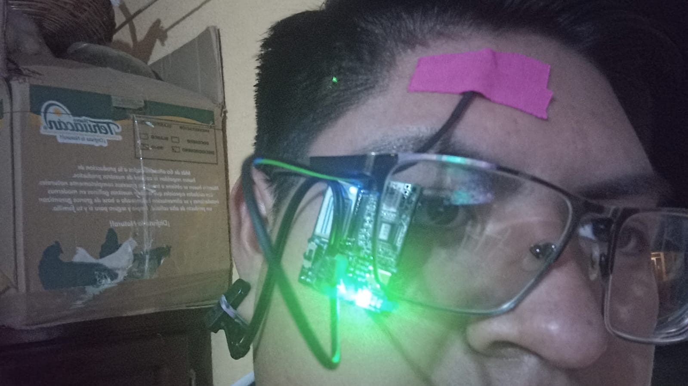
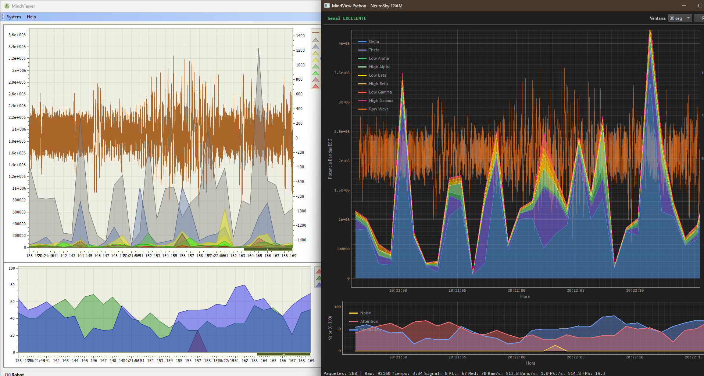
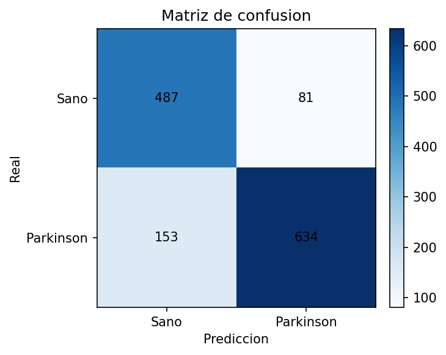
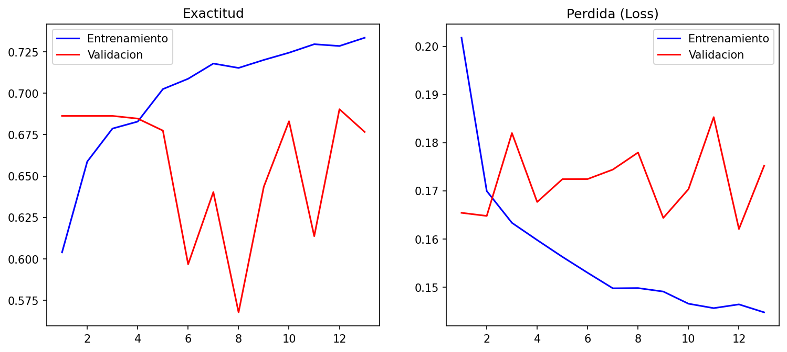

# Parkinson's EEG with a Low-Cost Sensor (NeuroSky TGAM)

**English** · [Español](README.es.md)

End-to-end research platform to study whether a **single-channel, low-cost EEG** (NeuroSky TGAM)
carries information that separates people with Parkinson's disease from healthy controls:
from reverse-engineering the sensor's binary protocol to a CNN evaluated **per patient**.

> ⚠️ **Research prototype, not a medical device.** It does not diagnose Parkinson's disease
> and must not be used for clinical decisions.

<p align="center">
  
  
</p>
<p align="center"><sub>Left: TGAM module with the dry electrode at Fp1. Right: official MindView vs. this project's viewer reading the same live stream.</sub></p>

---

## What's inside

| Phase | Result | Key decision |
|---|---|---|
| **1. Device reading** | Python parser for the TGAM binary protocol (`0xAA 0xAA LEN PAYLOAD CHK`), COM port auto-detection, checksum validation | Ported from the vendor's C#/C code and fixed bugs found in it (e.g. Meditation `0x05` was never parsed) |
| **2. Real-time viewer** | PyQt6 + PyQtGraph clone of MindView at 512 Hz: stacked 8-band power, raw wave, attention/meditation, signal-quality indicator | Dropped matplotlib (could not keep up); validated against MindView running **simultaneously** through a virtual serial-port splitter |
| **3. Recording** | Two CSVs per session (raw @ 512 Hz, bands @ ~1 Hz) written incrementally from a background thread, with metadata headers | CSV is the single source of truth; images for ML are generated later, never from screenshots |
| **4. Preprocessing** | 2 s windows (50 % overlap), normalization, **Gramian Angular Field** images, public dataset integration | A TGAM-vs-OpenNeuro compatibility study led to using **raw single-channel EEG** as the shared signal and GAF instead of spectrograms |
| **5. Modeling** | Compact 2D CNN on 128×128 GAF images, focal loss, threshold calibrated on validation | Iterated v1→v5 and caught two evaluation traps (see below) |
| **6. Real-time inference** | *Future work* | |

## Pipeline

```mermaid
flowchart LR
    A[TGAM<br/>1 channel, 512 Hz] -->|serial, binary| B[Parser +<br/>checksum]
    B --> C[Live viewer<br/>PyQtGraph]
    B --> D[CSV recorder]
    E[OpenNeuro ds002778<br/>Fp1 → 512 Hz] --> F
    D --> F[2 s windows<br/>50 % overlap]
    F --> G[GAF 128×128]
    G --> H[2D CNN]
    H --> I[P&#40;Parkinson&#41;]
```



**Data.** The model is trained on [OpenNeuro ds002778](https://openneuro.org/datasets/ds002778)
(UC San Diego, resting state, 15 PD + 16 controls; PD patients recorded both on and off medication).
Only channel **Fp1** is used — the closest position to the TGAM's forehead electrode — resampled
to 512 Hz to match the device. Local TGAM sessions are used to check signal compatibility.

## Results

Compact 2D CNN on GAF images, **evaluated on 5 people it never saw** (3 controls, 2 PD; 1,355 two-second windows).
The split is grouped by person, so no individual appears in more than one of train / validation / test.

| Metric (per 2 s window) | Value |
|---|---|
| ROC AUC | **0.899** |
| PR AUC | 0.924 |
| Balanced accuracy | **0.831** |
| Precision / Recall | 0.887 / 0.806 |
| F1 | 0.844 |

Per person (mean probability over all windows): in the 9 people held out from training (validation + test),
**every Parkinson's patient scored above every control.**

<p align="center">
  
  
</p>

**Read with care:** the test set has only 5 people, so the numbers depend heavily on who lands there;
predicted probabilities sit in a narrow 0.63–0.68 band; validation curves are noisy and the best weights come from epoch 3 (overfitting starts early); and the model has not been tested on TGAM recordings
from Parkinson's patients. It is a promising signal, not evidence of clinical performance.
Full history (v1 → v6) in [`reportes/FASE_5_REPORTE.md`](reportes/FASE_5_REPORTE.md).

## Lessons learned

1. **Accuracy lied — twice.** Model v4 reported 86 % accuracy, but its ROC AUC was 0.50: the test set was
   86 % Parkinson and the network always answered "Parkinson". Fixed with a class-balanced split,
   focal loss, PR-AUC-based checkpointing and a validation-calibrated threshold.
2. **Patient-level data leakage.** Each PD patient has two recordings (on/off medication). Splitting by
   *recording* put the same person in train and test, so the model could recognize individuals instead of
   the disease. Splitting by *person* is the only honest evaluation; the numbers above use it.
3. **Validate the hardware first.** Comparing the Python viewer side by side with the vendor's software
   caught parser bugs before any data reached a model.

## Quick start

```bash
git clone https://github.com/AdolfoHMtz/parkinson-eeg-tgam.git
cd parkinson-eeg-tgam
python -m venv .venv && .venv\Scripts\activate      # Windows
pip install -r requirements.txt

python visualizar_eeg.py --demo        # live viewer with synthetic data (no hardware needed)
python visualizar_eeg.py               # with a TGAM connected (COM port auto-detected)
python leer_tgam.py                    # console reader

# Preprocess the bundled OpenNeuro Fp1 data and train the CNN
python -m src.preprocesamiento.pipeline --fuente publico --rama b
python -m src.modelos.entrenar_cnn_rama_b datos/procesados/rama_b_gaf_v2.0s_o50_balanceado/datos.npz
```

See [`datos/README.md`](datos/README.md) for what data is included and how to regenerate the rest.

## Repository layout

```
src/
  conexion/          serial port auto-detection
  parser/            TGAM binary protocol (state machine + checksum)
  visualizacion/     real-time viewer (PyQt6 + PyQtGraph, thread-safe ring buffer)
  exportacion/       incremental CSV recorder
  preprocesamiento/  windows, normalization, GAF, OpenNeuro loader, per-person split, GUIs
  modelos/           CNN training and evaluation
herramientas/        TGAM-vs-OpenNeuro compatibility study, .npz/GAF inspectors
reportes/            per-phase reports and technical manual (Spanish)
guias/               implementation plan and operating guides (Spanish)
```

## Limitations and next steps

- 31 people is a small cohort; results vary depending on which patients land in the test set.
- The model was trained on research-grade EEG (BioSemi) and has not yet been validated on TGAM
  recordings from people with Parkinson's disease.
- Medication state (on/off) may act as a confounder.
- **Next:** sequence models on raw windows (1D-CNN / LSTM / GRU, "branch A"), session-level inference
  from a TGAM recording, and data collection with clinical partners.

## Credits

Developed by **Adolfo Huerta Martínez** as social service (*servicio social*) at the
**Benemérita Universidad Autónoma de Puebla (BUAP)**, supervised by **Mtro. Miguel Ángel Vargas Lomelí**.

Dataset: Rockhill, A. P., Jackson, N., George, J., Aron, A., & Swann, N. C. (2020).
*UC San Diego Resting State EEG Data from Patients with Parkinson's Disease.* OpenNeuro ds002778.

Licensed under the [MIT License](LICENSE).
