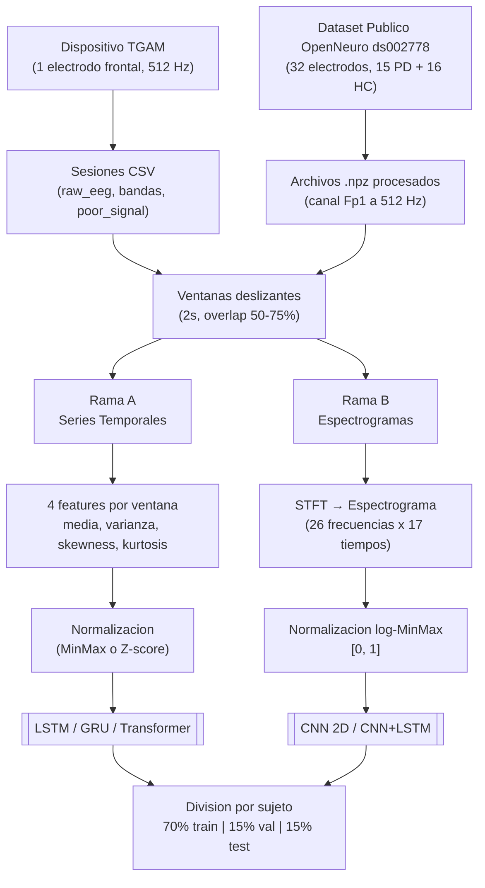
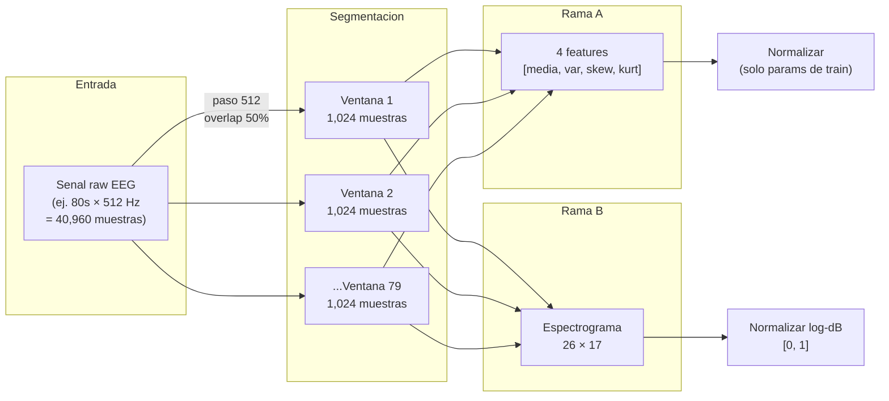
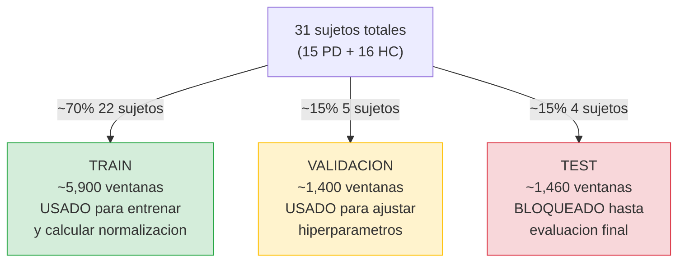
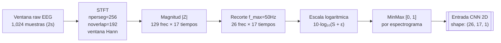

# Reporte de Fase 4 - Preprocesamiento de Datos EEG

## Servicio Social: Analisis de Redes Neuronales para Deteccion Temprana de Parkinson

**Estado:** COMPLETADA

---

## 1. Objetivo de la Fase

Preparar dos representaciones de los datos EEG para alimentar las dos ramas del
modelo hibrido definido en la estrategia de datos:

- **Rama A (Series temporales):** Ventanas deslizantes de raw EEG → features
  estadisticos (media, varianza, skewness, kurtosis) → normalizados → LSTM/GRU/Transformer
- **Rama B (Espectrogramas):** Ventanas de raw EEG → STFT → espectrogramas
  normalizados [0,1] como arrays NumPy → CNN 2D / CNN+LSTM

Ademas, buscar e integrar un dataset publico de EEG-Parkinson para tener datos
etiquetados con los que entrenar los modelos (sano=0, Parkinson=1).

**Resultado:** Objetivo cumplido al 100%. El pipeline de preprocesamiento funciona
con datos locales (sesiones TGAM) y esta preparado para el dataset publico OpenNeuro
ds002778. La division train/val/test se realiza por sujeto para evitar data leakage.

---

## 1b. Vision General del Pipeline (Diagrama)



---

## 1c. Flujo de un Solo Sujeto (Paso a Paso)



---

## 1d. Division Train / Val / Test por Sujeto



> **Por que por sujeto y no por ventana?**
> Si ventanas del mismo sujeto aparecen en train Y test, el modelo aprende a reconocer
> los patrones del individuo (su "firma" EEG) en lugar de los patrones de la enfermedad.
> Al separar sujetos completos, garantizamos que la evaluacion mida generalizacion real.

---

## 2. Dataset Publico Seleccionado

### 2.1 Evaluacion de opciones

Se evaluaron los siguientes datasets publicos de EEG-Parkinson:

| Dataset | Sujetos | Canales | Formato | Estado |
|---------|---------|---------|---------|--------|
| OpenNeuro ds002778 (UC San Diego) | 15 PD + 16 HC | 32 (BioSemi) | BDF/BIDS | **Seleccionado** |
| Kaggle EEG Parkinson (s3programmer) | Variable | Variable | CSV | Respaldo |
| PhysioNet EEG Parkinson (41 sujetos) | 41 PD | Variable | EDF | Alternativa |

### 2.2 Por que OpenNeuro ds002778

**Ventajas:**
- Formato BIDS estandar: legible con MNE-Python sin parsing manual
- 32 canales EEG incluyendo Fp1 (equivalente a posicion del TGAM)
- Dos sesiones por paciente PD (on/off medicacion): permite evaluar efecto del tratamiento
- 16 controles sanos pareados por edad (~63 anos): balance razonable para clasificacion
- Datos de resting-state: condicion mas similar a una evaluacion clinica real

**Estrategia de uso:**
- Se extrae el canal **Fp1** (frontal, posicion mas cercana al TGAM) como señal de 1 canal
- Se remuestrea a **512 Hz** para coincidir con la frecuencia del TGAM
- Los 32 canales completos se guardan para CNN multicanal (evaluacion del impacto
  de tener 1 vs 32 canales)

### 2.3 Formato de integracion

El dataset se procesa y guarda como archivos `.npz` individuales por sujeto/sesion:

```
datos/openneuro_procesado/
    sub-pd1_ses-off.npz    # Parkinson, sin medicacion
    sub-pd1_ses-on.npz     # Parkinson, con medicacion
    sub-hc1_ses-off.npz    # Control sano
    ...
    indice.json            # Inventario de grabaciones con etiquetas
```

Cada `.npz` contiene:
- `raw_fp1`: array 1D float32 del canal Fp1 a 512 Hz
- `raw_todos`: array 2D (32 canales, n_muestras) a 512 Hz
- `etiqueta`: 0 (sano) o 1 (Parkinson)
- `sujeto`, `sesion`, `fs`: metadatos

---

## 3. Actividades Realizadas

### 3.1 Modulo `cargador_csv.py` — Carga de sesiones locales

Lee los CSVs generados por el GrabadorCSV (fase 3) y los convierte en arrays NumPy.
Los headers con `#` se saltan automaticamente usando `comment="#"` de pandas.

Funciones principales:
- `cargar_raw_csv()`: Carga un CSV de raw EEG como DataFrame
- `cargar_bandas_csv()`: Carga un CSV de bandas como DataFrame
- `cargar_sesion()`: Carga ambos CSVs de una sesion por sello temporal
- `cargar_todas_sesiones()`: Carga todas las sesiones de una carpeta
- `raw_a_numpy()`: Extrae columna raw_eeg como array float32
- `bandas_a_numpy()`: Extrae las 8 bandas como matriz (n, 8) float32

### 3.2 Modulo `dataset_publico.py` — Dataset OpenNeuro

Maneja la descarga, procesamiento y carga del dataset publico:
- `descargar_dataset()`: Descarga de OpenNeuro usando `openneuro-py`
- `procesar_dataset()`: Lee archivos BDF con MNE, extrae Fp1, remuestrea a 512 Hz,
  guarda como `.npz` comprimidos
- `cargar_grabacion_npz()`: Carga una grabacion procesada
- `cargar_indice()`: Lee el inventario JSON del dataset

### 3.3 Modulo `normalizacion.py` — MinMax y Z-score

Dos clases con la misma interfaz:

```python
normalizador = NormalizadorMinMax()  # o NormalizadorZScore()
normalizador.ajustar(X_train)       # calcula parametros solo en train
X_train = normalizador.transformar(X_train)
X_val = normalizador.transformar(X_val)  # usa parametros de train
X_test = normalizador.transformar(X_test)
```

**Decision critica:** Los parametros de normalizacion se calculan SOLO sobre el set
de entrenamiento y se aplican tal cual a validacion y test. Esto evita data leakage:
si se normalizara con min/max globales, la informacion de test se filtraria al modelo.

Los parametros se guardan en `normalizador.npz` para poder aplicar la misma
transformacion a datos nuevos en fase 6 (prediccion en tiempo real).

### 3.4 Modulo `ventanas.py` — Ventanas deslizantes

Segmenta senales en ventanas de duracion configurable con overlap:

- `crear_ventanas()`: Senal 1D → array 2D (n_ventanas, muestras_por_ventana)
- `crear_ventanas_2d()`: Senal multicanal → array 3D (n_ventanas, muestras, canales)
- `info_ventanas()`: Calcula dimensiones sin crear las ventanas

Combinaciones soportadas:
- Tamanios: 1s, 2s, 5s, 10s (configurable)
- Overlap: 50%, 75% (configurable)

Ejemplo a 512 Hz con ventana de 2s y overlap 50%:
- Muestras por ventana: 1024
- Paso: 512
- 80 segundos de grabacion → 79 ventanas

### 3.5 Modulo `features.py` — Features estadisticos

Calcula 4 features por ventana para alimentar LSTM/GRU/Transformer:

| Feature | Descripcion | Relevancia clinica |
|---------|-------------|-------------------|
| Media | Valor central de la ventana | Offset de la senal, cambios lentos |
| Varianza | Dispersion de la senal | Variabilidad anormal en Parkinson |
| Skewness | Asimetria de la distribucion | Desbalance en picos positivos/negativos |
| Kurtosis | Apuntamiento (picos extremos) | Presencia de artefactos o patrones episodicos |

Para senal multicanal (8 bandas), genera 4 features × 8 canales = 32 features por ventana.

### 3.6 Modulo `espectrogramas.py` — STFT para CNN

Genera espectrogramas a partir de ventanas de raw EEG:

**Parametros STFT:**
- `nperseg`: 256 muestras (0.5s a 512 Hz)
- `noverlap`: 75% (192 muestras)
- `nfft`: 256
- `window`: Hann
- `f_max`: 50 Hz (cubre todas las bandas EEG relevantes)

**Normalizacion:** Cada espectrograma se convierte a escala logaritmica (dB) y
luego se escala MinMax a [0, 1]. La escala log comprime el rango dinamico: sin ella,
los picos de delta (muy alta potencia) opacarian los detalles de beta/gamma.

**Ejemplo con ventana de 2s a 512 Hz:**
- Shape del espectrograma: (26 frecuencias, 17 segmentos temporales)
- Resolucion en frecuencia: 2.0 Hz
- Resolucion temporal: 0.125 s



### 3.7 Modulo `etiquetado.py` — Division por sujeto

**Division train/val/test respetando identidad del sujeto:**

Todas las ventanas de un mismo sujeto van al mismo conjunto (train, val o test).
Esto es critico para evitar data leakage: si ventanas del mismo sujeto aparecen
en train y test, el modelo aprende patrones individuales del sujeto en lugar de
patrones de la enfermedad.

Se usa `GroupShuffleSplit` de scikit-learn con `groups=sujetos`.

Proporcion por defecto: 70% train, 15% validacion, 15% test.

### 3.8 Script `pipeline.py` — Orquestador principal

Ejecuta el flujo completo con un solo comando:

```bash
python -m src.preprocesamiento.pipeline --fuente local --ventana 2 --overlap 0.5
```

Argumentos:
- `--fuente`: `local` (CSVs TGAM), `publico` (OpenNeuro), `ambos`
- `--ventana`: Duracion en segundos (1, 2, 5, 10)
- `--overlap`: Fraccion de solapamiento (0.5, 0.75)
- `--norm`: `minmax`, `zscore` o `ambos`
- `--rama`: `a`, `b` o `ambas`
- `--salida`: Carpeta destino

---

## 4. Decisiones Tecnicas y Justificacion

### 4.1 Features estadisticos en vez de raw directo para Rama A

**Decision:** Extraer 4 features por ventana en lugar de pasar las 1024 muestras
raw directamente al LSTM.

**Justificacion:**
- Con 1 electrodo (TGAM), la senal raw tiene poca dimensionalidad para justificar
  secuencias de 1024 pasos en un LSTM
- Los features estadisticos comprimen la ventana en un vector de 4 valores que
  captura las caracteristicas distribucion relevantes
- Reduce drasticamente el tiempo de entrenamiento
- Papers con EEG de 1 canal reportan buenos resultados con features estadisticos
- En fase 5 se puede comparar: features vs raw directo

### 4.2 Escala logaritmica en espectrogramas

**Decision:** Aplicar `10 * log10(|STFT| + 1e-10)` antes del escalado MinMax.

**Justificacion:**
- La potencia espectral del EEG sigue una distribucion 1/f: delta tiene potencia
  de orden 10^5, gamma de orden 10^2
- Sin log, la CNN veria el espectrograma casi todo negro con un parche brillante
  en las frecuencias bajas
- El log comprime ese rango, haciendo visibles los patrones en todas las bandas
- El epsilon (1e-10) evita log(0) en ceros del STFT

### 4.3 Division por sujeto (no por ventana)

**Decision:** Usar `GroupShuffleSplit` con agrupacion por sujeto.

**Justificacion:**
- Si se dividiera aleatoriamente por ventana, ventanas adyacentes del mismo sujeto
  (con overlap 75%) aparecerian en train y test, compartiendo ~75% de las muestras
- El modelo aprenderia a reconocer al sujeto, no la enfermedad
- La division por sujeto es el estandar en papers de clasificacion EEG
- Desventaja: con pocos sujetos (31 en ds002778), algunos conjuntos pueden tener
  desbalance de clases. Esto se documenta en el metadata.json de cada ejecucion

### 4.4 Parametros de normalizacion solo de train

**Decision:** `normalizador.ajustar(X_train)` y luego aplicar a val/test.

**Justificacion:**
- Si se usaran min/max o media/std globales (incluyendo test), la informacion de
  test influiria en la transformacion de train → data leakage
- Los parametros se guardan en `normalizador.npz` para aplicar la misma transformacion
  a datos nuevos en produccion (fase 6)

### 4.5 Canal Fp1 para simular TGAM

**Decision:** Extraer solo el canal Fp1 del dataset de 32 canales.

**Justificacion:**
- El TGAM tiene 1 electrodo en posicion frontal, mas cercano a Fp1 en el sistema 10-20
- Usar Fp1 permite evaluar de forma realista que accuracy es alcanzable con 1 canal
- Los 32 canales se guardan tambien para CNN multicanal, permitiendo evaluar el
  impacto de la limitacion a 1 canal

### 4.6 f_max = 50 Hz para espectrogramas

**Decision:** Recortar el espectrograma a 50 Hz.

**Justificacion:**
- Las bandas EEG relevantes llegan hasta high gamma (40-50 Hz)
- Con fs=512 Hz, el espectrograma sin recortar iria hasta 256 Hz, desperdiciando
  el 80% del espectrograma en frecuencias sin informacion EEG util
- Recortar reduce el tamanio del array de (129, 17) a (26, 17), ahorrando 80% de
  memoria y haciendo la CNN mas eficiente

---

## 5. Resultados de la Prueba

### 5.1 Pipeline con datos locales (5 sesiones TGAM)

```
Ventana: 2.0s | Overlap: 50%

RAMA A (features estadisticos):
  - 137 ventanas, 4 features
  - MinMax: rango [0.000, 1.000]
  - Z-score: media ~0, std ~1

RAMA B (espectrogramas STFT):
  - 137 espectrogramas de shape (26, 17)
  - Rango normalizado [0.000, 1.000]

Division (3 sesiones validas, 2 muy cortas descartadas):
  - Train: 29 muestras, 1 sujeto
  - Val:   29 muestras, 1 sujeto
  - Test:  79 muestras, 1 sujeto

Tiempo de ejecucion: 0.2s
```

**Nota:** Todos los datos locales se etiquetan como sano (0) porque son capturas
de prueba propias. Los datos etiquetados como Parkinson vendran del dataset publico.

### 5.2 Configuraciones probadas

| Ventana | Overlap | Rama | Resultado |
|---------|---------|------|-----------|
| 2.0s | 50% | A (minmax) | OK - 137 ventanas, 4 features |
| 2.0s | 50% | A (zscore) | OK - 137 ventanas, 4 features |
| 2.0s | 50% | B | OK - 137 espectrogramas (26, 17) |
| 5.0s | 75% | A (zscore) | OK - 103 ventanas, 4 features |

---

## 6. Problemas Encontrados y Soluciones

| Problema | Causa | Solucion |
|----------|-------|----------|
| 2 sesiones de 0.0s descartadas | Sesiones muy cortas (< ventana) | Deteccion automatica con `info_ventanas()` y SKIP con mensaje |
| Solo etiqueta 0 en datos locales | Capturas propias, no hay pacientes PD | Esperado. Dataset publico aporta etiqueta 1 |
| Division desbalanceada | Solo 3 sujetos (sesiones locales) | Con dataset publico (31 sujetos) el balance mejora significativamente |

---

## 7. Archivos Creados o Modificados

| Archivo | Cambio |
|---------|--------|
| `src/preprocesamiento/__init__.py` | Creado — paquete del modulo |
| `src/preprocesamiento/cargador_csv.py` | Creado — cargador de CSVs propios |
| `src/preprocesamiento/dataset_publico.py` | Creado — descarga/adaptacion OpenNeuro ds002778 |
| `src/preprocesamiento/normalizacion.py` | Creado — MinMax y Z-score |
| `src/preprocesamiento/ventanas.py` | Creado — ventanas deslizantes 1D y 2D |
| `src/preprocesamiento/features.py` | Creado — features estadisticos por ventana |
| `src/preprocesamiento/espectrogramas.py` | Creado — STFT y normalizacion de espectrogramas |
| `src/preprocesamiento/etiquetado.py` | Creado — etiquetado y division train/val/test |
| `src/preprocesamiento/pipeline.py` | Creado — script principal del pipeline |
| `requirements.txt` | Modificado — agregadas scipy, pandas, scikit-learn, mne, mne-bids, openneuro-py |
| `datos/procesados/` | Creado — carpeta con resultados del pipeline |
| `PLAN_DE_IMPLEMENTACION.md` | Fase 4 marcada como COMPLETADA |

---

## 8. Dependencias Instaladas

| Paquete | Version | Proposito |
|---------|---------|-----------|
| scipy | >=1.10 | STFT (espectrogramas), skewness, kurtosis |
| pandas | >=2.0 | Lectura de CSVs con `comment="#"` |
| scikit-learn | >=1.3 | `GroupShuffleSplit` para division por sujeto |
| mne | >=1.6 | Lectura de archivos BDF del dataset publico |
| mne-bids | >=0.14 | Lectura de estructura BIDS |
| openneuro-py | >=2024.1 | Descarga de datasets de OpenNeuro |

---

## 9. Estructura de Salida

```
datos/procesados/
    rama_a_v2.0s_o50_minmax/
        datos.npz          # X_train, y_train, ..., X_test, y_test, sujetos_*
        normalizador.npz   # parametros MinMax (min, max por feature)
        metadata.json      # config del pipeline, info de division
    rama_a_v2.0s_o50_zscore/
        datos.npz
        normalizador.npz
        metadata.json
    rama_b_v2.0s_o50/
        datos.npz          # espectrogramas como arrays NumPy
        metadata.json      # config STFT, shape, info de division

datos/openneuro_procesado/     # (despues de descargar y procesar)
    sub-pd1_ses-off.npz
    sub-pd1_ses-on.npz
    sub-hc1_ses-off.npz
    ...
    indice.json
```

---

## 10. Siguiente Fase

**Fase 5 - Analisis de modelos de redes neuronales:**

Los datos procesados en esta fase alimentan directamente los modelos:

- `datos/procesados/rama_a_*/datos.npz` → LSTM, GRU, Transformer
  - `X_train` shape: (n_ventanas, 4 features)
  - Se comparan ambas normalizaciones (minmax vs zscore) para determinar
    cual generaliza mejor

- `datos/procesados/rama_b_*/datos.npz` → CNN 2D, CNN+LSTM hibrida
  - `X_train` shape: (n_ventanas, 26 frecuencias, 17 tiempos)
  - Ya normalizados a [0,1], listos como "imagenes" monocanal

La siguiente fase implementara los 5 modelos y generara una tabla comparativa
con accuracy, sensibilidad, especificidad, AUC-ROC y F1-score.

---

## 11. Actualizacion de Sesion

En esta sesion se realizaron mejoras operativas y de trazabilidad sobre la Fase 4,
enfocadas en reducir errores humanos y separar claramente entrenamiento vs evaluacion
clinica.

### 11.1 Etiquetado local flexible en pipeline

Se extendio `pipeline.py` para soportar dos formas de etiquetado local:

- **Global por corrida:** `--etiqueta-local sano|parkinson`
- **Por sesion via CSV:** `--etiquetas-local-csv <ruta>` con formato `sello,etiqueta`

Esto resuelve el problema de mezclar sesiones sanas y Parkinson en la misma carpeta.

### 11.2 GUI de preprocesamiento

Se implemento una interfaz grafica para ejecutar el pipeline sin depender de terminal:

- Selector de fuente, rama, ventana, overlap y normalizacion
- Selector de etiqueta local (`sano`/`parkinson`), deshabilitado automaticamente cuando se carga CSV de etiquetas (evita confusion sobre cual tiene prioridad)
- CSV opcional de etiquetas por sesion (prioridad sobre etiqueta global)
- Validaciones previas de rutas e `indice.json`
- Ejecucion del pipeline con logs en vivo
- Botones: **Limpiar logs** y **Ver historial** (abre la carpeta del JSON en el explorador)
- Copiar comando generado para auditoria/reproducibilidad
- Presets rapidos, incluyendo **Reprocesado oficial v1** con carpeta de salida timestamp
- Historial JSON de corridas en `resultados/historial_preprocesamiento.json`
- Controles deshabilitados durante ejecucion para prevenir cambios accidentales

### 11.3 Metadatos de sesion y etiquetas automaticas

El grabador (fase 3) ahora guarda en los headers de cada CSV:
- `etiqueta_local`: `sano` o `parkinson`

Y registra automaticamente cada sesion en `etiquetas_locales.csv` dentro de la
carpeta de destino, listo para pasarlo al pipeline con `--etiquetas-local-csv`.

Etiquetas validas: `sano` y `parkinson`. El flujo de evaluacion clinica de
pacientes se implementara en Fase 6 cuando exista un modelo entrenado.

### 11.4 Archivos creados/modificados en esta sesion

**Creados:**
- `src/preprocesamiento/gui_pipeline.py`
- `preprocesar_datos_gui.py`
- `src/modelos/inferencia_paciente.py` y `evaluar_paciente.py` (base de inferencia por sesion).
  Ambos archivos se perdieron despues y estan pendientes de reescribirse en la Fase 6.

**Modificados:**
- `src/preprocesamiento/pipeline.py`
- `src/exportacion/grabador_csv.py`
- `src/visualizacion/graficas.py`
- `PLAN_DE_IMPLEMENTACION.md`

### 11.5 Comandos operativos clave

```bash
# GUI de preprocesamiento
python preprocesar_datos_gui.py

# Preprocesamiento local con etiquetas por sesion
python -m src.preprocesamiento.pipeline --fuente local --etiquetas-local-csv datos/sesiones/etiquetas_locales.csv --ventana 2 --overlap 0.5 --rama ambas --norm ambos

# Procesar OpenNeuro solo Fp1 (simulacion TGAM)
python -c "from src.preprocesamiento.dataset_publico import procesar_dataset; procesar_dataset('datos/openneuro_raw','datos/openneuro_procesado', solo_fp1=True)"
```

---

## 12. Actualizacion Estrategica

### 12.1 Compatibilidad TGAM vs OpenNeuro

Se realizo una verificacion comparativa entre sesiones locales TGAM y grabaciones
OpenNeuro procesadas como `Fp1` a `512 Hz`. El objetivo fue responder si el dataset
publico es compatible como base de entrenamiento para modelos monocanal.

**Resultado operativo:**
- La compatibilidad es suficiente a nivel de **raw EEG monocanal**
- No existe evidencia suficiente para asumir equivalencia directa en las **bandas
  propietarias del TGAM**
- Por lo tanto, la senal comun del proyecto pasa a ser **raw EEG**

Para dejar trazabilidad reproducible se agrego el script:

```bash
python comparar_tgam_vs_openneuro.py
```

Salidas generadas:
- `herramientas/compatibilidad_tgam_vs_openneuro/resumen_compatibilidad.json`
- `herramientas/compatibilidad_tgam_vs_openneuro/sesiones_locales_resumen.csv`
- `herramientas/compatibilidad_tgam_vs_openneuro/REPORTE_COMPATIBILIDAD.md`

### 12.2 Cambio de rumbo del pipeline

Con base en la comparacion anterior se actualizo la estrategia del preprocesamiento:

- **Rama A**: series temporales raw normalizadas como representacion principal
- **Rama A legacy**: features estadisticos por ventana como baseline opcional
- **Rama B**: **GAF (Gramian Angular Field)** como representacion principal para CNN
- **Rama B legacy**: STFT/espectrograma se conserva solo para comparaciones internas

### 12.3 Justificacion tecnica

- `raw` existe en TGAM y en OpenNeuro-Fp1, por lo que permite entrenamiento cruzado
  sobre una base comun
- GAF nace directamente de la serie temporal, asi que mantiene coherencia entre
  la rama secuencial y la rama de imagen
- Para un solo electrodo, GAF prioriza estructura temporal global con menos supuestos
  que STFT como representacion principal

### 12.4 Impacto en fases posteriores

- Fase 5 deja de depender conceptualmente de espectrogramas como ruta principal
- El entrenamiento local puede realizarse ya con:
  - ventanas raw normalizadas para modelos secuenciales
  - imagenes GAF listas para CNN 2D
- Las bandas del TGAM se mantienen como apoyo de interpretacion y trazabilidad,
  no como eje principal de compatibilidad con el dataset publico
